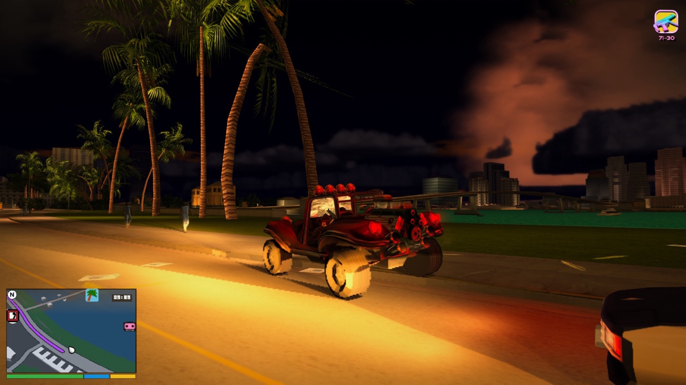
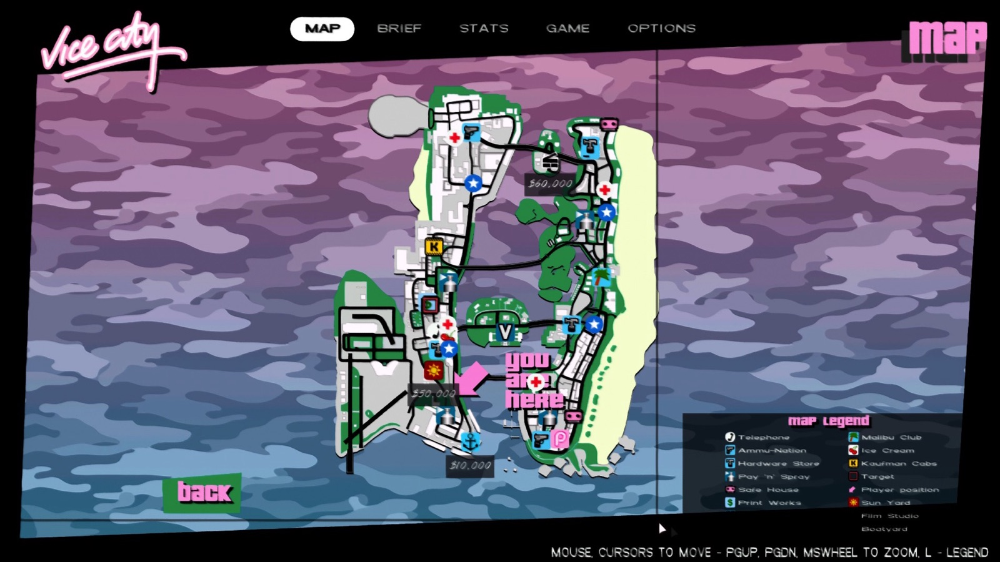
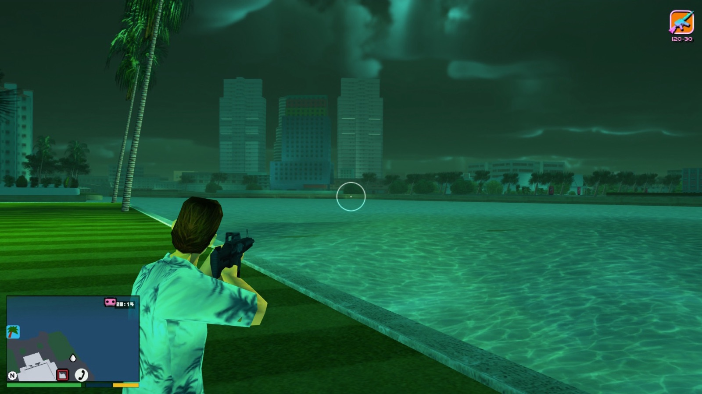
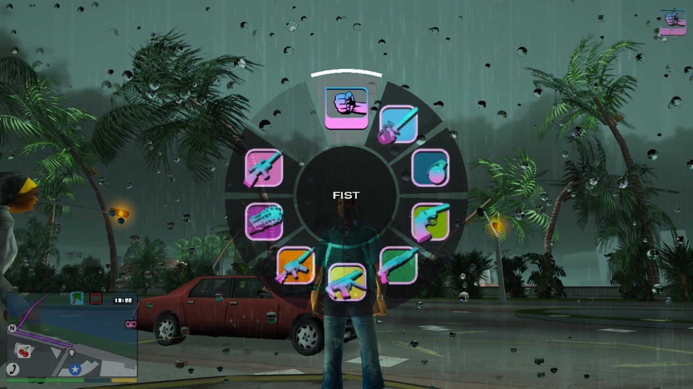
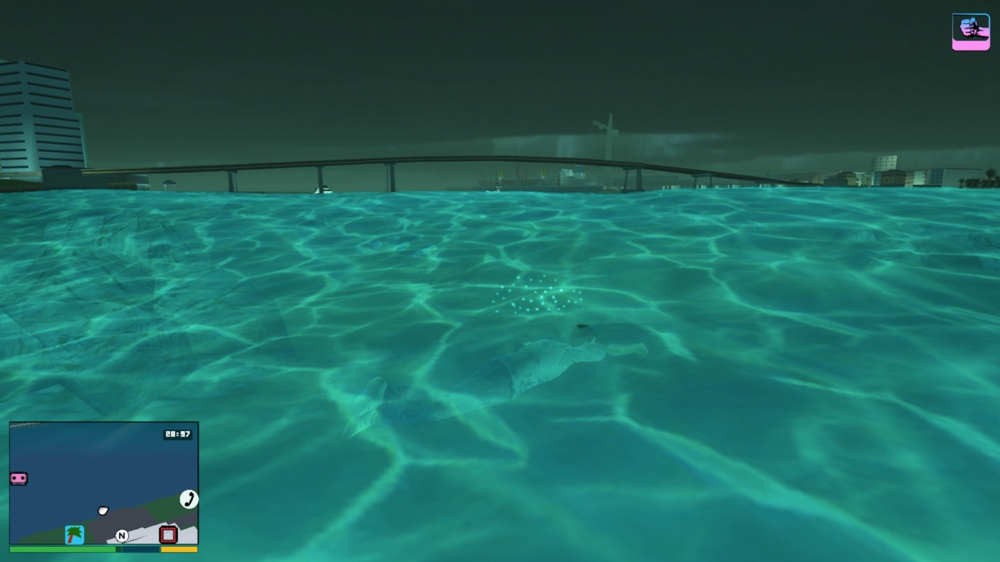

# Modernized Grand Theft Auto: Vice City

Vice City on the Mac, playing like a Rockstar game from the last decade.

This mod is for the native Apple Silicon port of Vice City, which is built from reVC. It brings in what
GTA IV, GTA V and Red Dead Redemption 2 made standard:

- a tilted GPS minimap and a modern HUD;
- a GTA V controller layout, with over-the-shoulder aiming, smooth sticks and free-aim drive-bys;
- a true first-person view, on foot and from the driver's seat;
- swimming, climbing and walking crouched;
- gunfights from cover, with bullet time and the shootdodge;
- police who know only what they've seen, RDR2-style: witnesses, your description, a search, an APB;
- volumetric clouds, and traffic that doesn't pop in.

Vice City's story, missions and world stay as they are. Every feature can be switched off.



## What it changes

### Map and HUD



- A rectangular minimap, tilted in 3D like GTA VI's. It's drawn from the game's own buildings and roads.
- GPS routes along the road network to your waypoint or the next mission objective. The waypoint clears
  when you arrive. There's no road route while you fly.
- Health, armour and stamina show as bars under the map, and your breath does when you dive. The clock
  sits on the map.
- Money appears only when it changes, or where you can spend it. The weapon is smaller, in the top-right
  corner, with the wanted stars above it.
- When you change station, its logo shows at the bottom of the screen instead of the big coloured name.
- A GTA IV-style pause menu opens on the map, with the other pages in tabs. The map has a compact legend,
  marks hospitals, police stations and businesses you can buy, with their prices, and shows the GPS route
  as soon as you set a waypoint.
- On the pause map, a tooltip names the icon under the cursor, and the controller's cursor snaps onto icons
  as it nears them. A/Cross, or a right click, makes that place your destination: the GPS routes there and
  its icon gets a purple border, on both maps, instead of the waypoint's square. The legend calls the
  waypoint "Destination".
- HUD shapes (the stars, the wanted icons, the eyes) have smooth edges, though the game draws its 2D
  without anti-aliasing.

### Controls and camera

<p>
  
  
</p>

- A GTA V controller layout ([below](#controls)). It's read straight from the controller, so it works
  whatever the game's own button mapping is.
- The game's hints and the mod's prompts name the button that does it now ("Press RT to fire", "D-pad up
  to answer"), not the PS2 layout's. They follow the controller you have (PlayStation, Xbox or Switch
  icons) and switch to your keys as soon as you touch the keyboard, a hint already on screen too. A few
  hints whose controls changed, like the drive-by tutorial, are reworded.
- The mod's own controls have keyboard keys too ([below](#keyboard-and-mouse)), and a few actions the new
  layout had left without a button got one: the RC helicopters' bombs, the Predator's cannons, arming a
  car bomb, an armed vehicle's handbrake and a plane's rudder.
- Smooth sticks. The game read each stick only past a third of the way out, then jumped, and each axis on
  its own, so walking snapped to straight lines. Now both sticks have one small round dead zone and
  answer in any direction: a gentle push on the left stick walks, and the right stick turns the camera
  smoothly, with its own sensitivity while aiming.
- Over-the-shoulder aiming on LT, and you can walk while aiming. The M4, Ruger and M60 use it too (the
  game used to aim them in first person). Two-handed guns stay at the shoulder while you walk, pointing
  where the crosshair is.
- Weapon and radio wheels, with time slowed while they're open.
- Free-aim drive-bys: hold LB in a vehicle with an SMG or a pistol, aim anywhere with the right stick, and
  fire with RB.
- The triggers work as analog pedals in cars, and as throttle and climb in helicopters and planes.
- The controller rumbles for crashes, explosions and punches.
- GTA IV-style camera shake: handheld on foot, a gentle sway and jolts in vehicles.

### First person

- The camera button (Select/Back) goes near, mid, far, then into Tommy's eyes. The view is steadied the
  way modern shooters do it, with a light step bob. His head is hidden so it never clips into the camera.
- Guns are held as in Call of Duty or Counter-Strike: low on the right, raised to just under the
  crosshair with LT. They kick when fired, dip when reloading and drop while sprinting. His left hand
  holds the gun where his own aiming pose does. Shots go where the dot is, from the hip or aimed.
- Look far enough round and he turns to face that way.
- In a vehicle you sit in the driver's seat, looking out through the car with his hands on the wheel:
  - The right stick looks around the cabin, and the view recentres when you let go. R3 looks back.
  - Getting in and out stays in first person.
  - On a motorcycle the view leans with you.
  - Drive-bys aim from the seat.
  - Flying, the pilot's hands are empty: you can't shoot from the controls.
- Cars' steering wheels are round and turn as you steer, with Tommy's hands on them. Sounding the horn
  (clicking the left stick), he presses its middle; when the blinkers come on, he flicks the stalk behind
  it.

### On foot



- Tommy swims instead of drowning: front crawl, a sprint, and treading water. Jump dives, with a breath
  meter. A sinking car gives you time to get out.
- Jump also climbs. He vaults low walls, steps up and pulls up onto ledges (even mid-jump), and climbs out
  of the water onto docks, piers and boats.
- Tommy walks crouched. Crouch, then push the stick: he creeps along low with his gun ready, and strafes
  while aiming. Sprinting or jumping stands him up.
- RDR2-style responses: greet or insult people up close, and pick up or wave off hookers.

### Gunfights

- Bullet time, as in Max Payne. While aiming, click the right stick to slow everything but your aim. It
  uses up stamina and ends when you click again, let go of LT or run out.
- The shootdodge. While aiming, jump with the stick pushed and Tommy dives that way through the air,
  still shooting. He lands, then gets up off his back or front with the game's own animations, turning to
  your aim as he comes up. The dive is in bullet time if you have the stamina.
- Gunmen fight from cover. They shoot from range instead of running up to you, then make for the nearest
  solid cover, like a wall, a car or a crate. They crouch behind it and stand or lean out to shoot.
- They keep their heads down while you're looking at them, and come up to shoot when you look away.
  Shoot at them, or hit someone next to them, and they run for cover or stay down in it.
- From further off they close in cover to cover. Only a few shoot at once, from cover; the rest stay
  down or move up while those cover them, and take a turn as soon as one's free. So they spread out
  around you instead of standing in the open waiting to be shot.
- They use cars as cover: a cop out of his car gets behind it. They go round a car or a corner to reach
  cover behind it, and duck down to reload.
- Shoot the car they're behind and they leave it once it's smoking. If it catches fire, anyone near it
  runs clear of the blast before it blows, to other cover if there is some.
- Coming from out of sight, they wait round the corner for the others and come at you together.
- Their aim is off when they first see you and tightens the longer they have you in sight, so standing
  about in the open gets you hit.
- A gunman who can't see you comes round to where he can, following the walkways round walls, instead of
  shooting at the wall. No one shoots you through a wall any more.

### Police

- The police are a force spread over the city: patrol cars on the roads everywhere, more where there's
  more traffic, and a few waiting at each station. When you're wanted, the nearest are sent and drive by
  road to where they think you are, so how soon the first one arrives depends on where you are. They come
  in out of your sight: through the gate of a walled lot, never inside it, and on a nearby road you can't
  see if they can't arrive where they are.
- More are sent the longer it goes on, and more at once for more stars. Destroy a car and kill its cops,
  and the next nearest is sent from further off.
- From two stars they set up roadblocks on the roads out of a ring round where they think you are. As time
  goes on there are more of them, and heavier: cars across part of the road, then all of it, then a cop
  with a spike strip in front, then a second line. Break out and they set up again.
- Once you've fired a gun, or while you aim one, cops draw their pistols instead of running up with the
  nightstick.
- The game lets only ten cops chase you at once. Now every cop near you on foot joins the fight from two
  stars. Roadblock cops leave a car of theirs that's caught fire.
- Cars coming for you on foot pull up short, side-on, round a corner if there is one, and the cops get
  out behind them. Wanted on foot, police arrive in cars, instead of appearing on foot wherever you can't
  see, even inside walls with you.

### Wanted: the police know only what they've seen

The game's police always knew exactly where Tommy was. Now a crime has to be seen and reported, the police
know you by your description, and getting away leaves you under an APB until you save.

**How a crime reaches them**

- A cop who sees a crime of yours files it there and then, from as far as he can see it, with your
  description.
- Cops hear things too: gunfire within about 150 m, an explosion within 250 m, screams within 50 m. They
  search round where it seemed to come from, and nothing stops that call.
- A crime no cop sees has to be called in. People who saw it, if they're the sort to (the game's own
  temperaments), run off to call it, marked on the minimap as they go. One who gets away calls within
  about 20 seconds, and so does one who runs for one of the city's few payphones. Rich people downtown,
  on Starfish Island and in Vice Point often have a brick phone and call from where they stand. Only
  killing or knocking a witness down stops the call.
- In a built-up spot, someone at a window may call it in too, just the place, and that can't be stopped.
- A car alarm you set off gets called in by someone nearby, just the place.
- A call counts what the crime is worth, by the game's own rules, and gives the police the place, and your
  description if they saw you. Gun violence is always at least two stars. Something worth no stars on its
  own (taking a parked scooter, say) isn't called in at all.

**What they know**

- Your description is your outfit and the vehicle you were last seen in, by model and colour. It changes
  only when a cop or a police helicopter sees you, so changing clothes or cars in front of them doesn't
  help.
- Out of their sight they work from where you were last seen: units are sent there, the roadblocks go up
  round it, and the cars that were chasing you drive about the area, road to road, looking for you. Cops
  on foot fan out round it too, and a police helicopter circles it.
- A cop who's lost you has to recognise you again. An eye over him fills while he looks at you: fast from
  far off if you match the description, only up close if you don't. Off towards the edge of the screen,
  or behind you, the eye sits on a ring round the middle pointing his way, like a damage indicator. While
  an eye fills you hear it, a low swell rising as it goes, Hitman-style, and a sting when it's full: they
  have you again.
- While the police don't know where you are, no cops appear next to you out of nowhere (the game's spike
  strip cops at three stars included).

**Getting away**

- Once nobody's seen you for a while, the stars dim and the police search the area. Stay out of it till
  the search runs out (longer for more stars) and the stars go hollow: an APB, if they had your
  description or it was two stars or more. Otherwise you're clear.
- Under the APB nobody's after you, but a cop who recognises you brings the stars back where they were.
  A witness who saw someone in other clothes and another vehicle saw a stranger. Saving at a safehouse
  clears the APB, and so does being wasted or busted. Missions that set or clear your stars still do.
- Pay 'n' Spray and changing clothes no longer wipe the stars. A respray changes the car they're looking
  for and new clothes the outfit, so both help only if no cop sees you do it.
- Police bribes are gone from the map.

**On screen**

- The stars look like GTA IV and V's: white while they're on you, pulsing grey while they search, hollow
  under the APB.
- Round icons right of the minimap show what they know: a phone with a ring while a call's going through,
  a magnifier while they search, a badge under the APB, and your outfit and vehicle while they're on your
  description, struck through once you've changed them.
- In a police car you see what they see: the area they're searching, and the other police on the minimap
  (cars, cops on foot, helicopters, units out in the city). But once they're after you, they always know
  where their car is.

**From the air**

- The police helicopter no longer fires from its belly, and no SWAT rope down from it. Two SWAT officers
  kneel in its open doors with rifles, each shooting out of their own side, and only once the police know
  it's you. Shoot one and he falls out; with both down it keeps following you, telling the police where
  you are. The next helicopter has a fresh pair.
- Police helicopters fly some 35 m up instead of skimming the rooftops. Bullets hit them where you see
  them: the cabin, the tail boom, or a gunner through his open door. They take hits where they land,
  smoke and then burn as they're damaged, and go down after about a quarter as many hits as before.
- From four stars a second helicopter comes. At six stars the army's Hunter joins in: it hovers off to one
  side, turns to face you, and fires its cannon close in and its rockets from further off. It takes about
  three times the hits of a car to bring down, and leaves when the stars drop.

### The world and the story

- Cars and people appear far enough out that you don't see them pop in, and fade in when they do.
  There are more of them, so the streets near you aren't emptier.
- Traffic isn't the same car over and over. More models stay loaded, and the rarest one on the road is
  picked first.
- Story phone calls ring anywhere, even while driving. A 1980s brick phone slides up with the caller's
  name, D-pad up answers, and Tommy keeps moving.
- Car radios can be heard from the street, muffled through the bodywork and coming from where the car is.
  Your own car keeps playing after you get out, and so do stopped cars nearby. Getting into a car, you
  hear only that car's radio, and a police car plays the police scanner, not the station you just heard.
- Once the story waits on your businesses, Ken texts you what it needs, and those businesses get gold
  rings on the map. You can buy them on credit: a quarter down, and the rest is paid from their income.

### Graphics

- Volumetric clouds like a flight simulator's: billowing cumulus with rounded undersides and domed tops,
  over the curve of the earth, lit by the sun or moon in the colours of the time of day. There are more
  clouds, and greyer ones, in bad weather. The sun's glare dims behind thick cloud.
- A modern camera look: bloom, shafts of sunlight, softer highlights, a touch more contrast and a
  vignette. Vice City's lighting is baked into its models, so this is the look of the picture, not new
  lights.
- Cars' lights glow in the model itself, where they're painted on: tail lights brighten red when
  braking (and while a car waits with someone at the wheel), reversing lights go white, and headlights
  light up at night. A smashed light stays dark.
- With a GPS route, your car's blinkers come on as the next turn comes up, with a green arrow on the
  dash in the driver's seat.
- Together they cost about 4 ms a frame at 3440×1440 on an M4. Each frame, the clouds work out a
  quarter of their pixels at half resolution and carry the rest over from the last frame.

### Fixes

- reVC's own menu options show their names instead of "FED_VPL missing", including the Graphics Setup
  page, and the police car's name shows when you get in (its text key was in the wrong case).
- The game no longer crashes when someone gets off a bus whose animations had been unloaded.
- Brake, reverse and headlights no longer draw see-through boxes sticking out of the bodywork (a GTA III
  leftover).
- If the car radio gets stuck looping one moment of a song (this can happen after the pause menu), it
  now restarts on its own after a few seconds.
- You can get out of a car that's in the water, even one floating on its roof, and there are no footstep
  sounds while swimming.

## Controls

|                       | On foot                                                     | In a vehicle                                   |
| --------------------- | ----------------------------------------------------------- | ---------------------------------------------- |
| RT / LT               | Fire / aim                                                  | Accelerate / brake and reverse                 |
| LB                    | Hold for the weapon wheel                                   | Hold to aim a drive-by, RB fires               |
| D-pad left / right    | Switch weapon                                               | Change station; hold for the radio wheel       |
| D-pad down            | Zoom the map out, show your money                           | Zoom the map out, show your money              |
| D-pad up              | Answer the phone                                            | Answer the phone, start the side mission       |
| B / Circle            | Melee, reload                                               | Hold for the cinematic camera                  |
| A / Cross             | Sprint                                                      | The vehicle's gun (a car bomb, a bike's guns); an armed vehicle's handbrake, its RB fires |
| X, B / Square, Circle | Answer a prompt (greet, insult; pick up, wave off)          |                                                |
| Jump                  | Jump, vault, climb; dive in the water. Aiming, with the stick pushed: shootdodge |           |
| L3                    | Crouch (push the stick to walk crouched)                    | Horn                                           |
| R3                    | Aiming: bullet time                                         | Look behind                                    |
| Select / Back         | Camera distance, then first person                          | Camera distance, including the driver's seat   |

Flying a helicopter or plane: RT climbs (or opens the throttle) and LT descends, as far as they're pulled.
LB and RB turn the tail (a helicopter's, a plane's rudder), and the left stick pitches and rolls. A fires
the gun and drops the bombs (the Hunter's cannon, the Sea Sparrow's gun, the RC aircraft's bombs and
detonation), X fires the Hunter's rockets, and B holds the cinematic camera.

In the pause menu, LB/RB (or Q/E) switch tabs and B/Circle goes back. On the map, the left stick moves
the cursor (gently for small pushes; the D-pad nudges it), the right stick moves the map, LT/RT zoom in and
out about the cursor, and A/Cross sets or clears a waypoint, or on an icon makes it the destination.

### The Controls page

Options > Controls replaces the game's Controller Setup pages with one page and two tabs:

- **Controller:** a dot by the pad's name says how it stands: green when the game reads it, amber when
  something needs fixing (the reason is beside it, and when the game reads another pad, Y / USE THIS ONE
  switches to this one), and an empty ring when there's none. Below it, a picture of your pad (PlayStation,
  Xbox or Nintendo) with what each button does on foot, driving, flying or on the pause map; press a button
  and its line lights up. Vibration, inverted look and look sensitivity sit under it.
- **Keyboard & Mouse:** every action's keys, the game's and the mod's, on foot and driving. Pick a key, press
  the new one (Esc cancels); a key another action had is taken from it. The mouse's sensitivity, inverted
  look and mouse steering are at the end.

Everything saves as you change it (`macVC.ini`, and the settings file for the mod's keys and look
sensitivity), and the hints on screen name the new keys at once. Head bob in first person isn't a control:
it stays in `macVC.ini` (`HeadBob1stPerson`) until the game's own features get an Options section.

### Keyboard and mouse

The game's own keys are as you set them on the Controls page. The mod's own actions get these, unless a game action
already has the key (then that one has none until you set it on the Controls page, or in the settings file's `[Keys]`):

| Key | Does |
| --- | --- |
| Q (hold) | On foot, the weapon wheel; the mouse picks |
| G (hold) | In a vehicle, the radio wheel |
| R | Reload |
| Y / N | Answer a prompt: greet or insult, pick up or wave off |
| B | Aiming: bullet time |
| X (hold) | In a vehicle, aim a drive-by with the mouse; the vehicle fire key shoots |
| C (hold) | In a vehicle, the cinematic camera |
| M | The expanded minimap |

The phone is answered with the game's own action key (Tab). Reload and the cinematic camera come with the
GTA V layout (`ModernTriggers` and `ModernButtons` on), as B does on the controller.

## Install

You need:
- an Apple Silicon Mac;
- the macOS port of Vice City, version 1.0.5217, set up with your own copy of the game;
- the Xcode Command Line Tools (`xcode-select --install`).

```sh
git clone https://github.com/twalichiewicz/revc-modernized.git
cd revc-modernized
./install.sh    # quit the game first; add the app's path if it isn't in /Applications
```

The installer builds the mod, keeps a copy of the original game and patches it. It only patches the
exact 1.0.5217 build. Run it again whenever the port updates itself. If macOS blocks it, allow your
terminal under System Settings → Privacy & Security → App Management.

`./uninstall.sh` puts the original game back. Your saves are never touched.

## Settings

Settings live in `~/Library/Application Support/macVC/vcmodernhud.ini`, and every feature has a switch
there (1 on, 0 off). The file explains each setting. It's written the first time the game runs, and isn't
updated after that. To pick up settings added by a newer version, delete it and a fresh one is written.

| Setting | What it does |
| --- | --- |
| **Map and HUD** | |
| `Enabled` | The minimap (0 gives the original round radar) |
| `GPS`, `AutoClearWaypoint` | The route to your waypoint or objective; the waypoint clears when you arrive |
| `Buildings`, `BuildingHeight` | 3D buildings on the minimap, and how tall (1 is their true height) |
| `Bars`, `Hud`, `MoneyPill` | The bars under the map; the clock on it and the smaller weapon and stars; money where you can spend it |
| `PauseTabs`, `CompactLegend`, `CircleBack` | The pause menu's tabs and legend; B/Circle goes back (0: Y/Triangle, as on the PS2) |
| `MapIcons` | On the pause map: tooltips, the cursor snapping to icons, and picking one as the destination |
| `Places`, `RadioLogo` | Map icons for hospitals, police stations and businesses; the station logo |
| `Tilt`, `Zoom`, `Size`, `Aspect`, `Margin` | The minimap's shape and place |
| **Controls and camera** | |
| `ModernTriggers`, `ModernButtons`, `DpadActions`, `Wheels` | The GTA V layout, the D-pad's actions and the wheels |
| `AimCamera`, `DriveByAim` | Over-the-shoulder aiming; free-aim drive-bys |
| `LookSensitivity`, `AimSensitivity` | Right stick speed, and while aiming |
| `FirstPerson`, `SteeringWheel` | First person in the camera cycle; round, turning steering wheels |
| `CameraShake` | 0 is none, 1 is the default, 2 is double |
| `Rumble` | Controller vibration |
| `MOD_WEAPON_WHEEL` … in `[Keys]` | The keyboard keys of the mod's own actions, written as macVC.ini's `[Bindings]` (`kbd:Q,2ndKbd:F1`, `mouse:MIDDLE`) |
| **On foot and gunfights** | |
| `Swimming`, `Climbing`, `CrouchWalk` | Swimming, climbing and walking crouched |
| `Interactions` | Greeting and insulting people, hookers |
| `SmarterEnemies` | Gunmen fighting from cover |
| `BulletTime` | Bullet time and the shootdodge |
| **Police and wanted** | |
| `SmarterPolice`, `Roadblocks`, `CopsByCar` | Police sent by road from across the city; the roadblocks; arriving by car |
| `RealisticWanted` | Witnesses, hearing, your description, the search and the APB |
| `HeliDamage`, `HeliGunners` | Shooting the police helicopter properly; its SWAT gunners, the second helicopter and the Hunter |
| **The world** | |
| `Phone`, `CarRadios`, `StoryHints`, `Credit` | Calls anywhere; car radios from outside; Ken's texts; buying businesses on credit |
| `SpawnDistance`, `CarVariety` | How much further out cars and people appear (1 is as the game had it); more car models |
| `Clouds`, `ModernLighting`, `LightGlow` | The new sky, the camera look, and cars' lights glowing on the model |

If something looks wrong, the log next to the settings file (`vcmodernhud.log`) usually says why. The
last three sessions are kept as `vcmodernhud.1.log` to `.3.log`, so a session that crashed isn't lost when
you start the game again. The log notes deaths, arrests, missions and cutscenes, what the police know and
do (calls, searches, recognitions, the APB), and how the helicopters fare. If the game freezes for 8
seconds, the log records where the game was stuck, which a force quit otherwise loses.

## How it works

The port is a native arm64 build of reVC with its symbols intact. At install time, `tools/patch_macvc.py`
writes a jump at the start of each game function the mod changes, pointing into a plugin built from
`src/`. The plugin works inside the game's own frame:

- It draws the HUD, menus and minimap through the game's 2D primitives, feathering every edge itself.
- It reads the controller through GLFW before the game merges it into its pad state.
- It renders the clouds and lighting with new OpenGL shaders inside the game's renderer.
- It poses Tommy bone by bone wherever the game has no animation: swimming, climbing, walking crouched,
  diving, and the arms holding a gun in first person and while walking aimed.
- It drives the police through the game's own functions and data: what the police know is a small model
  of its own (`src/heat.cpp`, with unit tests), kept in step with the game's wanted level, so missions
  that read or set your stars still work.
- It makes the spotted sound itself and plays it, and the car radios from outside, through the game's
  OpenAL.

The minimap is built from your own game files at install time, so nothing from the game is in this
repository.

## Development

- `make` builds the plugin.
- `make test` runs the unit tests (the minimap's projection, GPS turns, and the police's knowledge).
- `make preview` builds an offline renderer for the minimap and phone.

Each feature is its own module in `src/`, for example `camera.cpp` (first person), `swim.cpp`,
`clouds.cpp`, `police.cpp` and `wanted.cpp`. Each module's header says what it does and which game
functions it hooks. Offsets and call sites are for the 1.0.5217 binary only. The wanted system's design
and build plan are in `docs/superpowers/`.

## Known limits

- First person uses the game's own models. The guns are too low-detail for real iron sights, so LT
  brings them up under the crosshair instead. Tommy turns on the spot without a stepping animation.
- The shadows are the port's own ray-traced ones (`MetalRayTracing=1` in the port's `macVC.ini`). They
  can cost 5–28 ms a frame, and the mod's log shows their timings.
- Cops hear gunfire, so missions with street shootouts can draw a police search where the game never did.
- The helicopter door gunners' seats and the Hunter's flying were set from the models' measurements and
  may need tuning.
- Only the 1.0.5217 build of the port is supported. The installer refuses anything else.

## Credits

Built on reVC, the reverse-engineered Vice City source, and the native macOS port made from it.

## Disclaimer

A fan-made mod, not affiliated with or endorsed by Rockstar Games or Take-Two Interactive. It contains no
game code or assets: you need your own copy of the game and the macOS port. Use at your own risk;
`./uninstall.sh` restores the original game.

## License

[MIT](LICENSE)
