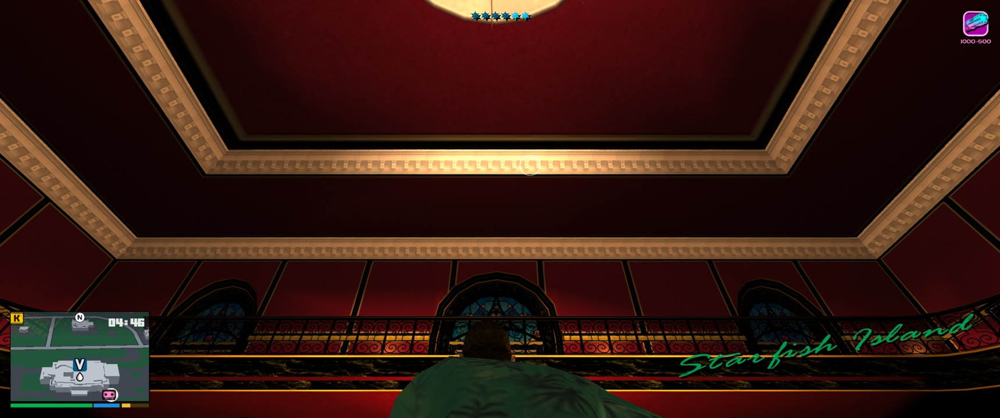

# Modernized Grand Theft Auto: Vice City

Vice City on the Mac, playing like a Rockstar game from the last decade.

This mod is for the native Apple Silicon port of Vice City, which is built from reVC. It brings in what
GTA IV, GTA V and Red Dead Redemption 2 made standard:

- a tilted GPS minimap and a modern HUD;
- a GTA V controller layout, with over-the-shoulder aiming and free-aim drive-bys;
- a true first-person view, on foot and from the driver's seat;
- swimming and climbing;
- volumetric clouds;
- traffic that doesn't pop in.

Vice City's story, missions and world stay as they are. Every feature can be switched off.



## What it changes

### Map and HUD
- A rectangular minimap, tilted in 3D like GTA VI's. It's drawn from the game's own buildings and roads.
- GPS routes along the road network to your waypoint or the next mission objective. The waypoint clears
  when you arrive.
- Health, armour and stamina show as bars under the map, and your breath does when you dive. The clock
  sits on the map.
- Money appears only when it changes, or where you can spend it. The weapon and wanted stars are smaller,
  in the top-right corner.
- When you change station, its logo shows at the bottom of the screen instead of the big coloured name.
- A GTA IV-style pause menu opens on the map, with the other pages in tabs. The map has a compact legend,
  and marks hospitals, police stations and businesses you can buy, with their prices.

### Controls and camera
- A GTA V controller layout ([below](#controls)). It's read straight from the controller, so it works
  whatever the game's own button mapping is. PlayStation controllers show their own button symbols.
- Over-the-shoulder aiming on LT, and you can walk while aiming. The M4, Ruger and M60 use it too
  (the game used to aim them in first person).
- Weapon and radio wheels, with time slowed while they're open.
- Free-aim drive-bys: hold LB in a vehicle with an SMG or a pistol, aim anywhere with the right stick, and
  fire with RB.
- The triggers work as analog pedals. The right stick is smooth, with its own sensitivity while aiming.
  The controller rumbles for crashes, explosions and punches.
- GTA IV-style camera shake: handheld on foot, a gentle sway and jolts in vehicles.

### First person
- The camera button (Select/Back) goes near, mid, far, then into Tommy's eyes. The view is steadied the
  way modern shooters do it, with a light step bob. His head is hidden so it never clips into the camera.
- Guns are held as in Call of Duty or Counter-Strike: low on the right, raised to just under the
  crosshair with LT. They kick when fired, dip when reloading and drop while sprinting. His left hand
  holds the gun where his own aiming pose does. Shots go where the dot is, from the hip or aimed.
- Look far enough round and he turns to face that way.
- In a vehicle you sit in the driver's seat, looking out through the car with his hands on the wheel:
  - The right stick looks around the cabin, and the view recentres when you let go. R3 looks back.
  - Getting in and out stays in first person.
  - On a motorcycle the view leans with you.
  - Drive-bys aim from the seat.

### On foot
- Tommy swims instead of drowning: front crawl, a sprint, and treading water. Jump dives, with a breath
  meter. A sinking car gives you time to get out.
- Jump also climbs. He vaults low walls, steps up and pulls up onto ledges (even mid-jump), and climbs out
  of the water onto docks, piers and boats.
- RDR2-style responses: greet or insult people up close, and pick up or wave off hookers.

### The world and the story
- Cars and people appear far enough out that you don't see them pop in, and fade in when they do.
  There are more of them, so the streets near you aren't emptier.
- Traffic isn't the same car over and over. More models stay loaded, and the rarest one on the road is
  picked first.
- Story phone calls ring anywhere, even while driving. A 1980s brick phone slides up with the caller's
  name, D-pad up answers, and Tommy keeps moving.
- Car radios can be heard from the street, muffled through the bodywork. Your own car keeps playing
  after you get out, and so do stopped cars nearby.
- Once the story waits on your businesses, Ken texts you what it needs, and those businesses get gold
  rings on the map. You can buy them on credit: a quarter down, and the rest is paid from their income.

### Graphics
- Volumetric clouds like a flight simulator's: billowing cumulus over the curve of the earth, lit by the
  sun or moon in the colours of the time of day. There are more clouds, and greyer ones, in bad weather.
  The sun's glare dims behind thick cloud.
- A modern camera look: bloom, shafts of sunlight, softer highlights, a touch more contrast and a
  vignette. Vice City's lighting is baked into its models, so this is the look of the picture, not new
  lights.
- Together they cost about 4 ms a frame at 3440×1440 on an M4. Each frame, the clouds work out a
  quarter of their pixels at half resolution and carry the rest over from the last frame.

### Fixes
- reVC's own menu options show their names instead of "FED_VPL missing", including the Graphics Setup
  page.
- The game no longer crashes when someone gets off a bus whose animations had been unloaded.
- If the car radio gets stuck looping one moment of a song (this can happen after the pause menu), it
  now restarts on its own after a few seconds.
- You can get out of a car that's in the water, and there are no footstep sounds while swimming.

## Controls

|                     | On foot                                | In a vehicle                                   |
| ------------------- | -------------------------------------- | ---------------------------------------------- |
| RT / LT             | Fire / aim                             | Accelerate / brake and reverse                 |
| LB                  | Hold for the weapon wheel              | Hold to aim a drive-by, RB fires               |
| D-pad left / right  | Switch weapon                          | Change station; hold for the radio wheel       |
| D-pad down          | Zoom the map out, show your money      | Zoom the map out, show your money              |
| D-pad up            | Answer the phone                       | Answer the phone, start the side mission       |
| B / Circle          | Melee, reload                          | Hold for the cinematic camera                  |
| X, B / Square, Circle | Answer a prompt (greet, insult; pick up, wave off) |                                    |
| Jump                | Jump, vault, climb; dive in the water  |                                                |
| R3                  |                                        | Look behind                                    |
| Select / Back       | Camera distance, then first person     | Camera distance, including the driver's seat   |

In the pause menu, LB/RB (or Q/E) switch tabs and B/Circle goes back.

## Install

You need:
- an Apple Silicon Mac;
- the macOS port of Vice City, version 1.0.5217, set up with your own copy of the game;
- the Xcode Command Line Tools (`xcode-select --install`).

```sh
git clone https://github.com/twalichiewicz/revc-modernized.git
cd revc-modernized
./install.sh    # quit the game first; add the app's path if it isn't in /Applications
```

The installer builds the mod, keeps a copy of the original game and patches it. It only patches the
exact 1.0.5217 build. Run it again whenever the port updates itself. If macOS blocks it, allow your
terminal under System Settings → Privacy & Security → App Management.

`./uninstall.sh` puts the original game back. Your saves are never touched.

## Settings

Settings live in `~/Library/Application Support/macVC/vcmodernhud.ini`, and every feature has a switch
there. The file explains each setting. It's written the first time the game runs, and isn't updated
after that. To pick up settings added by a newer version, delete it and a fresh one is written.

These are the ones you're most likely to want:

| Setting                     | What it does                                                              |
| --------------------------- | ------------------------------------------------------------------------- |
| `FirstPerson`               | First person in the camera cycle (on foot and in vehicles)                |
| `CameraShake`               | 0 is none, 1 is the default, 2 is double                                  |
| `SpawnDistance`             | How much further out cars and people appear (1 is as the game had it)     |
| `LookSensitivity`, `AimSensitivity` | Right stick speed, and while aiming                               |
| `Tilt`, `Zoom`, `Size`, `Aspect` | The minimap's shape                                                  |
| `Clouds`, `ModernLighting`  | The new sky and the camera look                                           |

If something looks wrong, the log next to the settings file (`vcmodernhud.log`) usually says why.

## How it works

The port is a native arm64 build of reVC with its symbols intact. At install time, `tools/patch_macvc.py`
writes a jump at the start of each game function the mod changes, pointing into a plugin built from
`src/`. The plugin works inside the game's own frame:

- It draws the HUD, menus and minimap through the game's 2D primitives.
- It reads the controller through GLFW before the game merges it into its pad state.
- It renders the clouds and lighting with new OpenGL shaders inside the game's renderer.
- It poses Tommy bone by bone wherever the game has no animation: swimming, climbing, and the arms
  holding a gun in first person.

The minimap is built from your own game files at install time, so nothing from the game is in this
repository.

## Development

- `make` builds the plugin.
- `make test` runs the unit tests.
- `make preview` builds an offline renderer for the minimap and phone.

Each feature is its own module in `src/`, for example `camera.cpp` (first person), `swim.cpp` and
`clouds.cpp`. Each module's header says what it does and which game functions it hooks. Offsets and call
sites are for the 1.0.5217 binary only.

## Known limits

- First person uses the game's own models. The guns are too low-detail for real iron sights, so LT
  brings them up under the crosshair instead. Tommy turns on the spot without a stepping animation.
- The shadows are the port's own ray-traced ones (`MetalRayTracing=1` in the port's `macVC.ini`). They
  can cost 5–28 ms a frame, and the mod's log shows their timings.
- Only the 1.0.5217 build of the port is supported. The installer refuses anything else.

## Credits

Built on reVC, the reverse-engineered Vice City source, and the native macOS port made from it.

## Disclaimer

A fan-made mod, not affiliated with or endorsed by Rockstar Games or Take-Two Interactive. It contains no
game code or assets: you need your own copy of the game and the macOS port. Use at your own risk;
`./uninstall.sh` restores the original game.

## License

[MIT](LICENSE)
