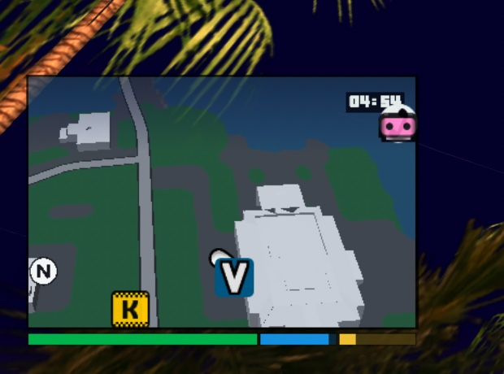
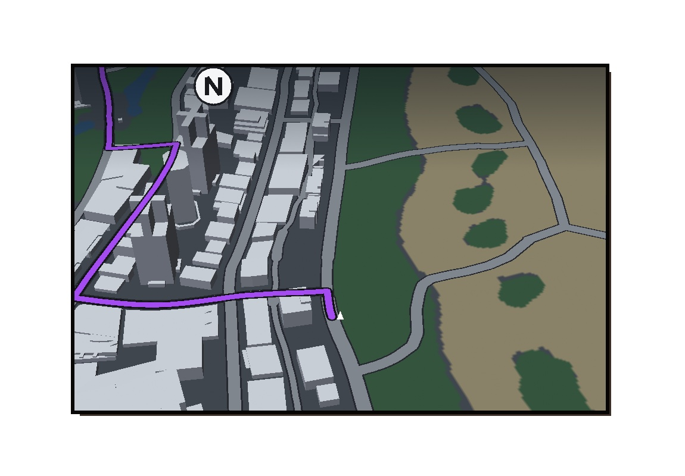
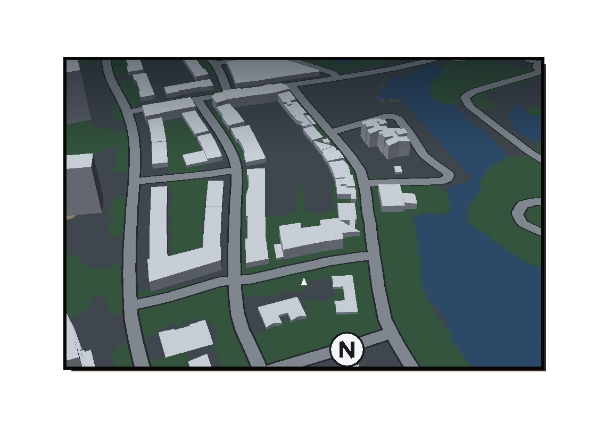

# VC Modern HUD

A modern GTA-style HUD and controller layout for the native Apple Silicon port of **Grand Theft Auto: Vice City** on macOS. It adds:

- a rectangular, tilted 3D minimap with real building shapes,
- GPS guidance to your waypoint or mission objective,
- health, armour and stamina bars under the map,
- a cleaner HUD around it,
- a GTA IV-style pause menu that opens straight on the map,
- GTA V-style weapon and radio wheels, and a D-pad that does something useful.


| In game | Offline preview: Ocean Beach | Offline preview: Vice Point |
|---|---|---|
|  |  |  |

## What you get

- **Tilted 3D minimap.** It sits in the bottom-left corner and rotates with the camera. It looks further
  ahead the faster you drive.
- **Real buildings.** They are built from the game's own collision meshes, so outlines and heights match the
  actual buildings, including stepped towers and sloped roofs.
- **Real roads.** They come from the game's car path network, drawn at their actual widths.
- **GPS route.**
  - With a waypoint set, the route leads there and clears itself when you arrive.
  - Otherwise it leads to the current mission objective, in the blip's colour. Enemy (red) blips are
    never routed to.
- **Blips.** They stay on the map edge when out of view. Shops and other short-range icons only show when
  they are on the map. A clear **N** marker always points north.
- **Status bars.** Health, armour and stamina sit under the map in a 3:1:1 split, replacing the numbers in the
  top-right.
- **HUD layout.**
  - The clock moves onto the map.
  - Money only shows where you can spend it: a small Red Dead 2-style pill to the right of the map appears
    at an Ammu-Nation counter or a property for sale.
  - The weapon and ammo are half size in the top-right corner.
  - Wanted stars appear centred at the top, only while you are wanted.
- **Pause menu, GTA IV style.**
  - Pausing opens the map directly. Brief, Stats, Game (resume, load, quit) and Options are tabs across the
    top: switch with LB/RB, Q/E or a click.
  - Back on a tab returns to the game. With a controller, Back is Circle (B on Xbox) instead of the PS2's
    Triangle (Y).
  - The map legend is a small panel in the bottom-right corner instead of covering the map.
  - On the map, A (Xbox) or ✕ (PlayStation) places a waypoint without also closing it. LT and RT zoom,
    since RB now switches tabs.
- **Controller, GTA IV/V style.**
  - Hold LB (L1) for the weapon wheel on foot, or the radio wheel in a vehicle. Point the right stick at a
    weapon or station and let go of LB to pick it; time slows while the wheel is open. A quick tap of LB
    still does what it always did (centre the camera, next station).
  - The D-pad no longer moves you. Left and right switch weapons on foot, and change the radio station in a
    vehicle.
  - On foot, LT aims and RT fires, instead of switching weapons. R1 and Circle no longer aim and fire, so they
    are free for other things.
- **Aiming, modern third-person style.** Holding LT with a gun eases the camera in over Tommy's right
  shoulder and zooms in, with the crosshair in the middle of the screen, pointing where the small hip-fire
  dot pointed before you aimed. The M4, Ruger and M60 aim this way too instead of switching to first person;
  sniper rifles and the rocket launcher keep their scopes, now steered with the right stick.
- **Precise right stick.** The camera follows the right stick smoothly from a small dead zone (the game's own
  stick handling ignored the first 30% and then jumped), slower while aiming and slower still through a
  zoomed scope.
  - PlayStation controllers work properly. The game's controller list maps the DualSense and DualShock 4 on
    macOS with the right stick's up/down on the same axis as L2, so the camera tilted when you pulled the
    left trigger. The mod corrects that at start-up, so turn Steam Input off for the game if you used it to
    work around this.

## Requirements

- An Apple Silicon Mac.
- `Grand Theft Auto Vice City.app`: the native macOS port, version **1.0.5217** (bundle id
  `com.github.gtamac.macVC`), set up with your own copy of the game's files. Check the version in the
  app's Get Info window.
- The Xcode Command Line Tools, installed with `xcode-select --install`, for `clang`, `make` and `python3`.

The installer only patches the exact 1.0.5217 binary. Other builds are refused, and the plugin also checks
the binary at run time, so it never touches a game it wasn't made for.

## Install

```sh
git clone https://github.com/twalichiewicz/vc-modern-hud.git
cd vc-modern-hud
./install.sh                                  # quit the game first
./install.sh "/path/to/Grand Theft Auto Vice City.app"   # if it isn't in /Applications
```

`install.sh` does five things:

1. Builds the plugin.
2. Saves the untouched game binary to `~/Library/Application Support/macVC/vcmodernhud/macVC.vanilla`.
3. Bakes the map data (roads, buildings, base map) and the radio wheel's station logos from **your** game
   files.
4. Patches and ad-hoc re-signs the game binary.
5. Copies `libVCModernHUD.dylib` into the app.

No game files are included in this repository.

If macOS blocks the write, allow your terminal under System Settings → Privacy & Security → App Management.

Launching through Steam (as a non-Steam game, Steam overlay included) works too.

The port's built-in updater replaces the app, so run `./install.sh` again after updating.

## Uninstall

```sh
./uninstall.sh
```

This restores the original binary and removes the plugin. Your saves are never touched.

## Using it

- **Set a waypoint:** right-click the map in the pause menu, or press A/✕ with a controller.
- **Settings:** `~/Library/Application Support/macVC/vcmodernhud.ini`, written on first run.

  | Key | Default | What it does |
  |---|---|---|
  | `Enabled` | 1 | 0 brings back the original round radar |
  | `GPS` | 1 | route line |
  | `AutoClearWaypoint` | 1 | remove the waypoint on arrival |
  | `Buildings` | 1 | 3D buildings |
  | `BuildingHeight` | 0.6 | 1 is true height |
  | `Bars` | 1 | health/armour/stamina under the map |
  | `Hud` | 1 | clock on the map, no money, small weapon and stars |
  | `MoneyPill` | 1 | money next to the map in shops and at property for sale |
  | `PauseTabs` | 1 | pause menu opens on the map, other pages as tabs |
  | `CompactLegend` | 1 | small map legend in the corner of the pause map |
  | `CircleBack` | 1 | Circle (B) goes back in menus; 0 restores Triangle (Y) |
  | `Wheels` | 1 | hold LB for the weapon / radio wheel |
  | `DpadActions` | 1 | D-pad left/right switch weapons / stations instead of moving you |
  | `ModernTriggers` | 1 | on foot LT aims and RT fires (instead of switching weapons) |
  | `AimCamera` | 1 | over-the-shoulder aiming, the hip-fire dot and the precise right stick |
  | `LookSensitivity` | 1 | right stick camera speed |
  | `AimSensitivity` | 0.45 | right stick speed while aiming or scoped (1 = as when not aiming) |
  | `Margin` | 0.025 | gap to the screen corner (fraction of screen height) |
  | `Tilt` | 50 | degrees of 3D tilt; 0 is flat |
  | `Zoom` | 1.5 | higher is closer |
  | `Size` | 1.25 | map height relative to the original radar |
  | `Aspect` | 1.55 | width / height |

- **Log:** `~/Library/Application Support/macVC/vcmodernhud.log`. Check here first if something looks off.
- The minimap replaces the radar when the radar mode is "map & blips". With the radar off, the original
  health, armour and clock come back.

## How it works

The port is a native arm64 build of reVC. Apple Silicon won't let a modified code page run again, so the
hooks are written to disk:

- **Patching.** `tools/patch_macvc.py` replaces the first instruction of each hooked function with a branch
  to a small stub in the binary's header padding.
- **Stubs.** Each stub jumps through a pointer slot that the plugin fills in when it loads. If the plugin is
  missing (it is loaded as a weak dylib), the slots stay empty and the game runs its original code.
- **HUD elements.** Two "skip" patches hide the top-right health and armour. Other HUD elements are recognised
  by where they are called from in `CHud::Draw`.
- **Controller.** `src/controls.cpp` hooks `CPad::Update`, between the game reading the gamepad and merging it
  into the pad state. It reads the gamepad through GLFW directly, takes the D-pad and LB out of the
  joystick's state, and drives the wheels (`src/wheel.cpp`). Weapons switch through the game's own
  `CPlayerPed::ProcessWeaponSwitch`, stations through its retune counter.
- **Aiming.** `src/aimcam.cpp` hooks the PC follow camera (`CCam::Process_FollowPedWithMouse`) and moves it over
  the shoulder while aiming. The game aims along that same camera and crosshair
  (`CCamera::Find3rdPersonCamTargetVector`), so shots still go where the crosshair points.
- **Pause menu.** `src/menu.cpp` opens the frontend on the map page, draws the tabs after each frontend frame
  and switches pages through the game's own `CMenuManager::SwitchToNewScreen`. The legend's drawing calls
  in `CMenuManager::PrintMap` and `CRadar::DrawLegend` are moved and scaled into the corner.

The plugin (`src/`) replaces `CRadar::DrawRadarMap` with its own scene (`src/scene.cpp`):

- a perspective projection of the radar plane (`src/projection.cpp`),
- a base map texture, the road network, and depth-buffered 3D buildings,
- the route, drawn through the game's own `RwIm2D` 2D pipeline.

The game still draws the blips, re-projected onto the map. Routing uses the game's own pathfinder
(`CPathFind::DoPathSearch`).

`tools/bake` builds the map data:

- **Land, water, parks and beaches** come from the radar art, with its painted roads and buildings removed.
- **Roads** come from `data/maps/paths.ipl`, at their real widths.
- **Buildings** are the roof surfaces of each map model's collision mesh. These are upward faces that nothing
  in the same model covers and that stand above the street, welded into connected roofs whose outlines
  become walls.

## Development

```sh
make            # plugin + bake tool
make test       # projection unit tests
make preview    # offline renderer for iterating on the look without the game:
build/vcmm-preview <map.bin> <roads.csv> <out.png> <x> <y> <heading> <range> [targetX targetY]
                # VCMM_PREVIEW_SCALE=2.5 renders a close-up
build/vcmm-bake <GameData> out.bin --area <x> <y> <size> area.png
                # top-down check: real collision vs extracted buildings and roads
```

Developer switches (environment variables, e.g. `open --env VAR=value "Grand Theft Auto Vice City.app"`):

- `VCHUD_DUMP_ROADS=path` writes the game's road network, which the preview uses for routing.
- `VCHUD_TEST_WAYPOINT=dx,dy` places a waypoint relative to the player.
- `VCHUD_TEST_WANTED=n` sets a wanted level.
- `VCHUD_TEST_MONEY=1` always shows the money pill.
- `VCHUD_TEST_WHEEL=1` opens the weapon or radio wheel once, without holding LB.
- `VCHUD_TEST_AIM=1` shows the aiming camera whenever a gun is out.

Struct offsets, symbols and call sites were read from the 1.0.5217 binary. Supporting another build means
re-deriving them; see `src/game.h`, `src/hud.cpp`, `src/menu.cpp`, `src/controls.cpp` and `tools/patch_macvc.py`.

## Disclaimer

This is a fan-made mod, not affiliated with or endorsed by Rockstar Games or Take-Two Interactive. It
contains no game code or assets: you need your own copy of the game and the macOS port. Use at your own
risk; `uninstall.sh` restores the original binary.

## License

[MIT](LICENSE)
