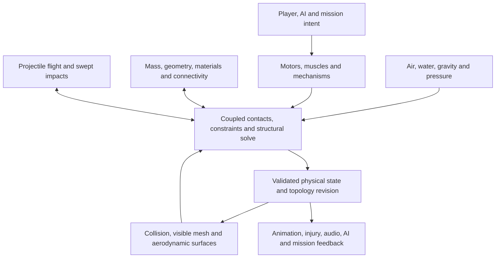

# Shared physical world and destructible assets

2026-11-05. Working design from the user's systemic-physics direction. This records the target and the engineering choices to evaluate; it does not claim that a new engine is installed or that a library choice has passed the feasibility gates.

## Intent

Every physical entity participates in the same world: vehicles and aircraft, people, held or dropped weapons, ammunition, debris, buildings, props, terrain and water. Engines, tires, wind, pressure, contacts and explosions apply loads. Material deformation and failed connections change geometry and functioning systems. Behavior must work for players, NPCs and mission entities through the same mechanisms.

For a wing clipping a building, the required chain is: swept contact at the wing; impulse and torque on the aircraft and reaction on the structure; stress transmitted through the wing attachment; elastic/plastic response or fracture according to the material; separation with conserved mass and momentum; changed lift, drag, control authority and balance; collision and visible geometry following the result. A generic hull-health decrease does not establish that chain.

## One world, with coupled numerical methods

One authoritative world does not require one numerical algorithm for every phenomenon. Rigid bodies, deformable structures, fluid/pressure approximations, actuators and thermal state may need different methods. They must exchange loads and state during the same controlled substeps, with verified two-way coupling. An independent deformation simulation that just follows the native car's pose recreates the present problem.

The shared module owns body identities, material state, constraints, topology revisions, the simulation clock and contact/load results. Its external interface should remain small: create/remove physical assets; submit intent and physical loads; advance time; query geometry; read snapshots/events. Native addresses and ABI offsets belong in the game adapter.

The arrows into the solve represent forces and coupled constraints within the physical step. A common event bus that distributes independent damage/velocity edits after several unrelated simulations is insufficient.

## Physical assets and materials

Each instance has a stable world identity and a physical asset graph:

- Mass distribution and full inertia tensors, solids or shells, material regions and collision representation.
- Load-bearing members, panels, welds, bolts, hinges, mounts and other connections, with rest configuration and strength.
- Actuators and functional networks attached to actual parts: engines, shafts, gears, wheels, rotors, control surfaces, cables, electrical supply, fuel, cooling and hydraulic paths.
- A rendering binding and semantic attachment points, including seats and weapon/control grips.
- Anchors/supports for structures, plus persistent per-instance changes.

Materials carry density, thickness, elastic response, damping, yield/plastic response, fracture behavior, friction/restitution and thermal properties as needed. Ballistic response also depends on projectile shape/speed and incidence. This is a common material description, not the assumption that a bullet and a slow collision cause identical damage for the same scalar number.

Vice City's render triangles and broad COLs do not specify sheet thickness, weld layout, internal machinery or material engineering data. Import geometry and authored metadata; mark estimated defaults explicitly. Authoring/model differences are data, not new hard-coded damage branches. Hollow space stays empty. Missing parts do not leave hidden absorbers or colliders.

Physical asset authoring is part of the deliverable. Start with one aircraft and one articulated vehicle/door fixture, including internal load paths and material thickness, then expand through reusable templates and model bindings. A missing model definition is reported as incomplete coverage; it does not justify labeling a cosmetic fallback as an equivalent simulation.

## Coverage

| System | Inputs to the world | Required physical outputs |
| --- | --- | --- |
| Cars, trucks, bikes, tanks and RC vehicles | Throttle/brake/steering intent, torque curves, gearing, drivetrain connections, suspension and tire state. | Wheel/ground forces, slip, traction, weight transfer, contact impulses, structural damage and changed handling. |
| Fixed-wing aircraft | Surviving lifting surfaces, air-relative velocity, density, control deflection, propulsion and mass distribution. | Distributed lift/drag/thrust and torque, stall/control changes, wing-root loading and detached parts. |
| Helicopters | Rotor geometry/inertia, engine/shaft torque, blade pitch, tail drive and local airflow. | Rotor forces and angular momentum, blade/world strikes, transmitted mast/boom loads and actual loss of control. |
| Boats and seaplanes | Hull shape, immersed volume, water motion/density, propulsion and contact. | Buoyancy, drag, slamming, flooding/changed mass and structural loads. |
| People | Animation/AI targets, bounded muscle/controller effort, body mass, contacts and held items. | Feasible locomotion, balance, two-way pushes, active ragdoll response and injury. |
| Guns and melee weapons | Trigger/strike intent, physical weapon and ammunition data, grip constraints. | Recoil, swept strikes/projectiles, penetration/ricochet, impact impulse, heat and fragments. |
| Explosions | Energy/pressure source, duration, obstruction and fragment distribution. | Occluded impulses on exposed surfaces, injury, joint/skin failure, debris and heat. Visual effects consume those results. |
| Buildings, windows, props and terrain | Collision geometry, materials, anchoring/support networks and environmental state. | Reaction forces, local material damage/penetration and released dynamic fragments where support fails. |
| Weather, rotor wash, jet wash and water jets | One shared flow/pressure environment, density and temperature fields. | Forces at exposed surfaces and heat/momentum transfer to all applicable recipients. |

An anchored building can remain a static or sleeping solver representation while still having material/support state. Its loads react into its foundation. This does not mean every city triangle must be an awake dynamic body, or that an aeroplane touching reinforced concrete should move the entire building.

Road/off-road behavior comes from tires, normal load, slip, rolling resistance, water and ground material/deformation. Utility gearing and engine torque must provide the corresponding wheel torque. Do not introduce a generic vehicle-class off-road multiplier as a replacement for those interactions.

Aircraft forces use relative airflow, not world speed alone. Coarse game meshes cannot uniquely determine accurate aerodynamic coefficients; surface metadata and validated models are necessary. Full real-time CFD is not assumed.

Projectiles use continuous swept collision/flight, including gravity and relevant drag/wind. Tiny fast bullets do not need to be ordinary discrete rigid bodies, but they must query the same authoritative geometry and deliver physical momentum/work. Player and NPC engagement range is separate from projectile lifetime/flight.

Characters and held weapons use constraints and bounded controllers. Animation must not teleport a person through a door or overwrite an accepted blast impulse. A rigid capsule/controller can be a documented low-detail representation; active ragdolls need the same coupled world when enabled.

Existing symptoms become causal acceptance cases: rotor audio follows actual shaft/rotor motion; loss of propulsion alone does not deny boarding; boarding depends on physical access/seat state and explicit game rules. Fuel ignition follows penetration, leakage, heat and exposure. Armor uses thickness, material and incidence, including SWAT/Gruppe Sechs vehicles, with finite structural limits. These apply to NPC and mission instances as well as the player.

## Force, work and topology contracts

- Use metres, seconds, kilograms, newtons, newton-seconds and joules inside the shared module. Native unit conversion occurs once in the adapter.
- Apply force/impulse at its actual location. Angular response uses the current mass distribution and inertia tensor.
- Equal and opposite interaction impulses apply to both dynamic recipients; static anchors represent the reaction into the world. External actuator/script/flow work is identified explicitly.
- Partition delivered work into recoverable strain, plastic deformation, fracture, heat and remaining projectile/fragment energy. Do not spend the full event budget independently on every touched system.
- Failure follows local material/connection state. Remove the failed constraint or split connectivity; compute fragment mass, centre of mass, inertia and velocities from the pre-split state.
- Rebuild/refit collision and aerodynamic geometry with the same topology revision as rendering. Update normals and notify shadow/reflection consumers; rendering correctness remains separately verified under issue49.
- Derive functional failures from physical connectivity and local state: a severed fuel line leaks; a disconnected wheel gets no drive torque; a lost wing supplies no lift; a broken tail drive loses anti-torque.

## Time, streaming and compatibility

Use one fixed-step clock with bounded, measured substepping. Render interpolation and macVC frame generation do not advance physics. Benchmark candidate rates before selecting a default. All adapters use the same gravity and unit convention; migrating the current game's approximately20m/s² gravity toward Earth gravity is an explicit compatibility/tuning decision, not an unnoticed conversion.

Use swept/continuous tests for fast translation and verify angular motion separately. A library's linear CCD does not automatically cover a rotating wing tip or rotor blade.

Keep nearby active interaction islands awake. Keep remote structures/bodies registered as static, sleeping or a lower-detail representation with equivalent semantic state. Persist damage across streaming. Pin collision cells ahead of fast aircraft/projectiles, independently of the camera, and preserve doors/interiors/roof geometry. Unknown/unloaded space is not a clearance certificate.

Detail transitions preserve mass, momentum, joint connectivity, permanent strain and functional state. A low-detail or sleeping representation remains part of the world; it is not deleted because it is off camera. Pin connected bodies across cell boundaries. Set the active-region and debris budgets from measured host workloads, including the cost of fracture and rebuilding geometry, rather than allowing arbitrary per-step work. During overload reduce noncritical representation/detail or simulation pacing explicitly; never silently skip required contacts or make projectiles miss.

At any instant a body is native-owned, solver-owned or explicitly kinematic. Exactly one owner advances its pose and velocity. A temporary unmanaged dynamic body interacting with a solver-owned body requires a verified two-way bridge or migration into the same world; mirroring it into a second world is insufficient.

Game scripts, missions, AI, animation, audio and UI integrate through the adapter. Controls become intent; teleports/creation/removal become explicit commands; collision queries read authoritative geometry. Native gravity/contact/damage code must be suppressed only for transferred bodies. Preserve pool-generation/world-epoch checks and legitimate script permissions. Avoid player-only physics and blanket mission immunity.

Migration is by complete interacting islands with verified ownership transfer. Native-only moving actors cannot be represented as immovable mirrors in the new world. Before any production migration, demonstrate that no participant is omitted or double-stepped and that pose/velocity writeback survives the remaining native callbacks. Failed initialization leaves the island under its original owner. Nonfinite solver output is rejected before host publication; fault handling retains the last valid state and reports the failed island instead of emitting invalid transforms or quietly resurrecting intact geometry.

## Approaches to evaluate

1. Continue augmenting native physics with a common event/structure layer. This preserves integration work but leaves the native rigid-body solver and custom deformables difficult to couple consistently. It cannot be advertised as the full target merely because damage code is shared.
2. Integrate an existing CPU multibody/deformable world behind a native adapter. This fits the installed arm64/C++17 plugin constraints if full native ownership transfer and authoritative queries can be proven. Thin metal, fracture and asset authoring still require substantial work.
3. Integrate at engine-source level when source becomes available. This provides clearer control over stepping, world queries, streaming and ownership, but the current public macVC distribution does not supply that source.

Compare Bullet's deformable/multibody world and Jolt's rigid/articulated world against the prior-art note. A rigid graph with breakable joints is a useful milestone, not proof of continuous plastic crumpling. A soft-body demo is not proof that deforming cars, aircraft, characters and world fragments all interact robustly. Do not choose an extra independent custom soft solver without a demonstrated coupling strategy.

**Engineering choice under the user's authorization to proceed:** evaluate the existing CPU coupled-world route first, behind a solver-independent game adapter; keep source-level integration preferable if host source becomes available. Bullet is first in evaluation order, not selected for production. Chrono is the next comparison if structural/contact mechanics require a different foundation. Jolt is a useful rigid/articulated baseline, with the narrower capability recorded explicitly. The user has not selected a particular SDK.

The [first ARM64 experiment](../../research/2026-11-05-world-physics-evaluation.md) builds Bullet and demonstrates rigid joint breakage and elastic contact. Unmodified code fails asymmetric momentum checks; an analytical contact probe identifies an unequal-mass impulse error. A separate experimental checkout with a one-line correction and projection enabled passes the five initial world cases, but a stronger light-face contact test exposes energy gain. The contact gate therefore remains failed. Broader contact/angular accounting, permanent plasticity/fracture and the native ownership bridge also remain unproven.

## Feasibility and acceptance gates

Before replacing production physics, run a reproducible headless comparison on this Apple Silicon host using pinned upstream revisions. It must test:

1. A wing/beam clipping a wall at speed and at an oblique angle: deceleration and angular impulse, yielding/failure at the struck attachment, conserved split mass/momentum, and a clear miss producing no collision.
2. Two deformable bodies colliding and exchanging momentum; a rigid body coupled to deformable structure; contact with self and thin sheets as applicable.
3. Persistent plastic set and fracture/topology updates. Explicitly separate features supplied by the engine from code still required.
4. A person/vehicle contacting a swinging attached panel and detached panel from both sides.
5. Fast projectiles crossing moving/deforming materials with entry/exit, empty-space, repeat-through-hole and ricochet checks.
6. An occluded explosion moving people, vehicles and debris through the same load interface; a nearby shielded object receiving less impulse.
7. Surface-relative airflow and changed aerodynamic area/mass after part loss.
8. Fixed physical results across30/60/120 rendered fps within stated tolerances, plus sleeping/waking, streaming, repair and mission/script transitions.

Record CPU time, memory, contact/constraint counts, step stability and topology-update cost. Do not publish a city-scale performance claim from a one-object demonstration.

After a candidate passes, prove one game bridge slice in the real native world: a physical wing clipping an ordinary building, a person pushing a door, and an explosion acting on both. Trace the authoritative owner and geometry revision before/after each native phase to catch double simulation or overwritten impulses. Offline native instruction tests remain compatibility tests, not substitutes for these acceptance cases.

Then migrate by interacting systems—world collision/queries and ownership first; articulated vehicle structure and mass; force producers; people and weapons; broader material/thermal/fluids and model coverage—while keeping one authoritative world. Do not add a fresh per-symptom damage branch for every failed interaction.

## Delivery boundary

The whole-world target is a multi-stage engine/asset integration project. The immediate work is feasibility and a verified host bridge, not a claim that all entities have already migrated. Establish conservation, contacts and an honest structural representation first; then connect functional networks, air/water/thermal models, every actor/weapon path and authored world assets. Each stage retains the full-world acceptance ledger and marks unimplemented participants explicitly.

The accompanying [feasibility plan](../plans/2026-11-05-world-physics-feasibility.md) covers that first stage only. Passing it does not close the full-world target. The fresh builder check returned “nothing important left”; remaining SDK, numerical-rate, authoring and runtime-hook choices are engineering investigations rather than unanswered user preferences.
